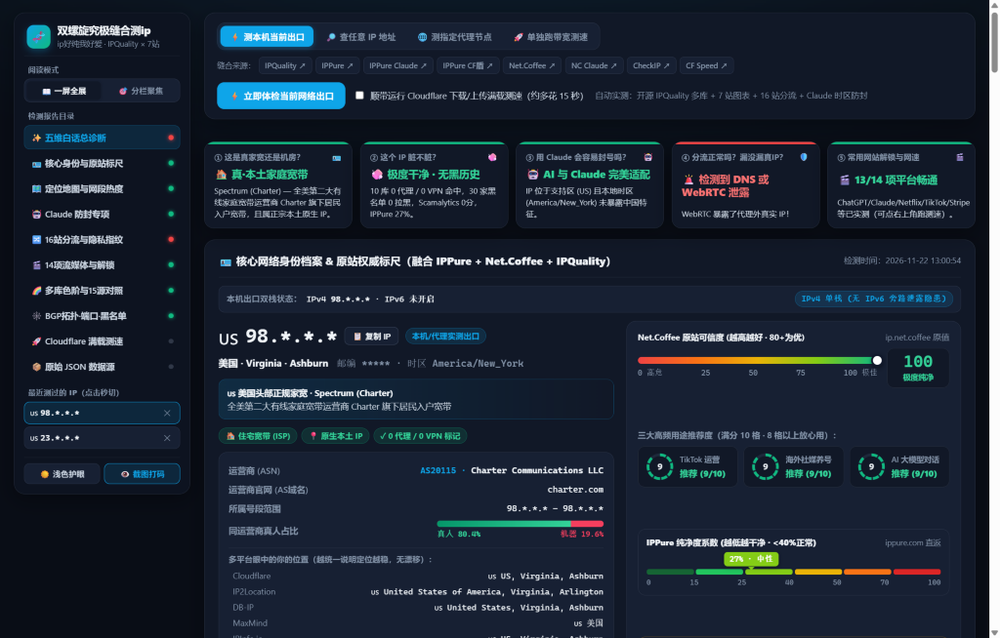
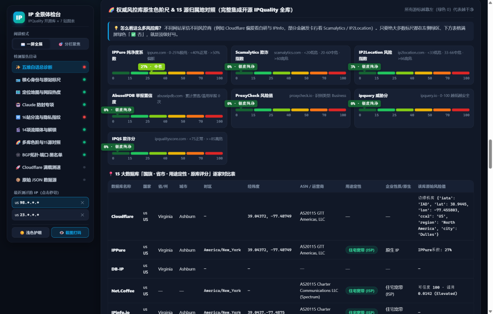
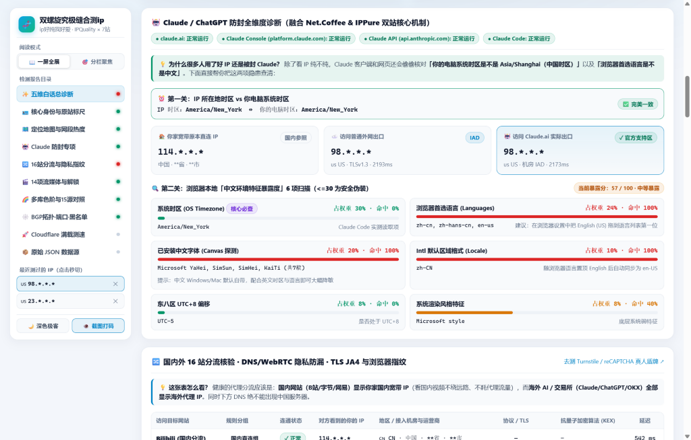

# 双螺旋究极缝合测ip（ip好纯我好爱）

买代理、抽家宽或者排查 Claude 封号的时候，以前要么得上机器跑一遍很火的开源检测项目 [xykt/IPQuality](https://github.com/xykt/IPQuality)（`IP.Check.Place`），要么得在浏览器里同时打开 **IPPure**（主站 / Claude 专项 / Cloudflare 检测）、**Net.Coffee**（IP 详情 / Claude 环境检测）、**CheckIP**、**Cloudflare Speed** 等七八个网站来回切标签页对比。

这个工具直接把 `xykt/IPQuality` 的多库体检能力，连同上面这几个常用网站的核心数据和原版图表，全都缝合进了同一个本地页面里。直接测当前出口、填代理链接或者只输一个 IP 都能查，顺带用大白话标出问题在哪。

## 解决什么问题

1. **辨别真假家宽**：不少商家拿国际骨干网（如 Lumen / Cogent）或机房段当“静态住宅”卖。直接核对运营商真实归属、BGP 三列国际路由拓扑、常见服务器端口开关，以及同网段 256 个邻居近 14 天的拥挤热度，避免买到假家宽或万人骑网段。
2. **一次看齐各家风控原值**：不搞自编打分，直接把 `IPQuality` 涵盖的十余家风控与地理库（IPPure、Net.Coffee、Scamalytics、IP2Location、AbuseIPDB、IPQS、IPInfo、ipapi 等）原值、流媒体解锁状态和 30 家黑名单放在一屏对比。
3. **排查为什么用了好 IP 还是封 Claude**：很多时候不是 IP 脏，而是电脑系统还挂着 `Asia/Shanghai` 中国时区或浏览器中文首选语言。页面会直接比对 IP 时区与本机环境特征暴露度。
4. **检查分流规则和满载网速**：实测 B 站/字节等国内站走没走直连、Claude/ChatGPT/OKX 有没有走代理、DNS 和 WebRTC 漏没漏国内真实 IP，以及 Cloudflare 下载/上传满载延迟（Bufferbloat）。

## 界面预览

左下角自带「截图打码」开关，开启后自动隐去 IP、邮编、坐标尾数与国内省市，方便直接截图发给别人看：







## 怎么运行

**本地 Python 运行：**

```bash
pip install -r requirements.txt
python app.py
```

启动后会自动打开浏览器访问本地页面。

**打包成独立 `.exe` 分享给朋友：**

Windows 下双击运行 `build_exe.bat`，生成的 `dist/双螺旋究极缝合测ip（ip好纯我好爱）.exe` 单文件发给别人双击即可使用，不需要装 Python。

## 说明

- 查询记录仅保存在本地 `ip_check_history.json`，不会上传任何外部服务器。
- 多源风控检测思路融合致敬了开源项目 [xykt/IPQuality](https://github.com/xykt/IPQuality) 及上述各公开检测站，离线地图轮廓来自 Natural Earth (CC0)，采用 [MIT](./LICENSE) 协议开源。
